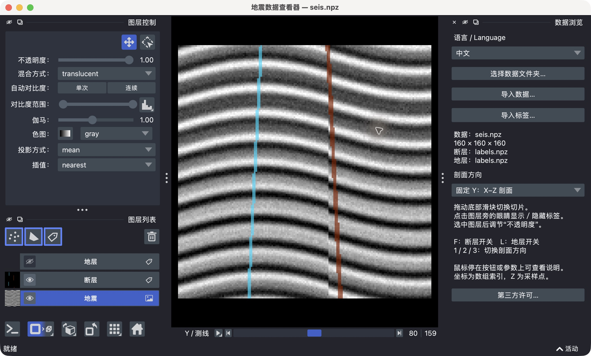
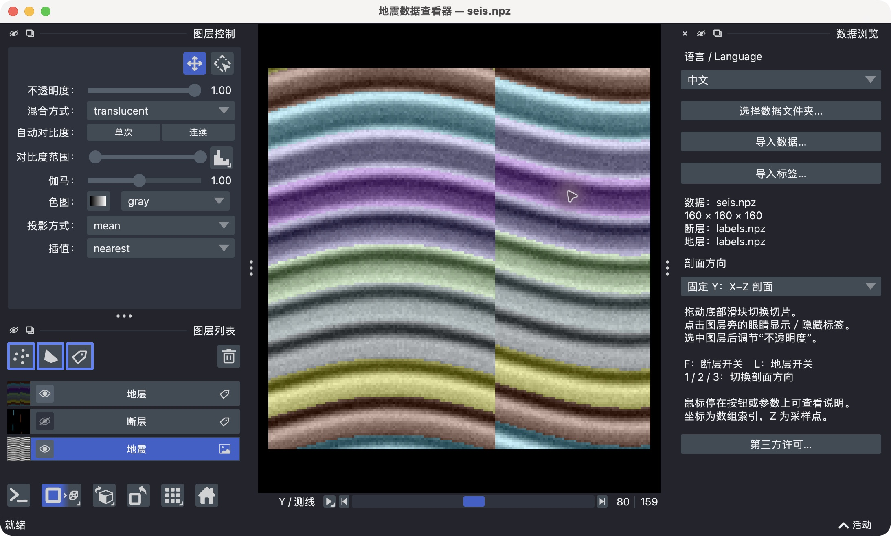
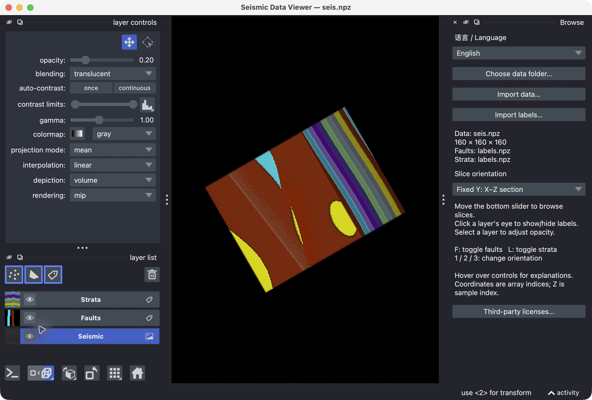
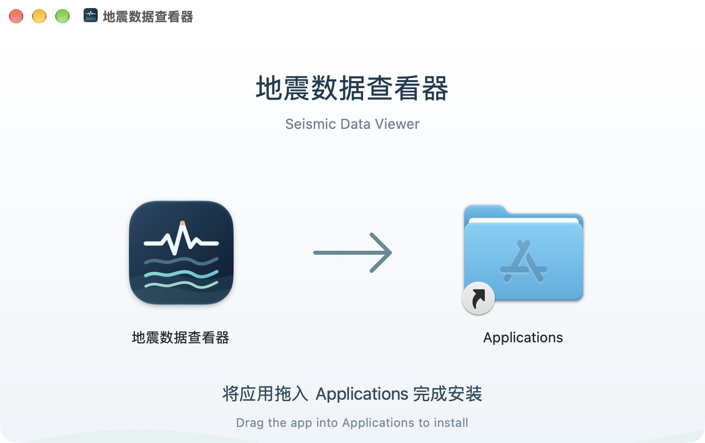

中文 · <a href="README.en.md">English</a> · <a href="https://github.com/findLink/seismic-data-viewer-app/releases/latest">下载最新版</a> · <a href="https://github.com/findLink/seismic-data-viewer-app/issues">反馈问题</a>

  

# 地震数据查看器

**双击打开，拖动滑块，在地震剖面与标签之间来回查看。**

Seismic Data Viewer 是一个用于检查 **三维 NPY / NPZ 地震数据、断层标签与地层标签**的桌面工具。适合数据检查、标注核对、教学演示，以及模型输出的可视化检查。日常使用不需要终端，不需要安装 Python；安装后可以离线打开本地文件。

这是应用的**公开下载与反馈仓库**。应用源码保持私有，软件按[应用许可](LICENSE.txt)免费提供个人及商业使用；它不是开源项目。第三方组件保留各自许可。

## 下载与试用

| 平台 | 安装包 | 要求 |
| --- | --- | --- |
| Apple Silicon Mac | [下载 Mac DMG](https://github.com/findLink/seismic-data-viewer-app/releases/download/v1.0.2/Seismic-Data-Viewer-1.0.2-macos-arm64.dmg) | M 系列，macOS 15+；不提供 Intel Mac 版 |
| Windows | [下载 Windows 安装包](https://github.com/findLink/seismic-data-viewer-app/releases/download/v1.0.2/Seismic-Data-Viewer-1.0.2-windows-x64-setup.exe) | x64；安装器最低要求 Windows 10 1809 |

**[查看最新版及全部附件](https://github.com/findLink/seismic-data-viewer-app/releases/latest)** · [下载合成演示数据](https://github.com/findLink/seismic-data-viewer-app/releases/download/v1.0.2/Seismic-Data-Viewer-1.0.2-demo-data.zip)

下载**无需登录 GitHub**。普通使用只需下载安装包；第三方源码包是许可配套材料，无需安装。Windows 界面/GPU 功能仍待更多实机测试。Mac 当前使用 ad-hoc 签名，尚无 Apple Developer ID/公证；Windows 尚无发布者签名。

*截图来自 Mac 版 1.0.2，使用专门制作的 160 × 160 × 160 合成演示数据，不包含真实勘探资料。截图中的颜色表示标签 ID。*

## 可以做什么

| 功能 | 使用方式 |
| --- | --- |
| **分别导入数据与标签** | 数据和标签可以在不同目录，先导入三维数据，再导入形状相同的标签；文件名不受固定名称限制。 |
| **三方向切片** | 选择固定 X、Y 或 Z 的剖面，拖动底部滑块逐张查看，检查空间位置是否对齐。 |
| **标签开关与叠加** | 分别显示/隐藏断层、地层，调节透明度，对照原始振幅查看边界与标注。 |
| **三维体与标签视图** | 在二维/三维之间切换，查看体数据与标签的空间分布；效果和速度取决于 GPU、驱动及数据规模。 |
| **显示参数** | 调整对比度、伽马、色图、插值和三维渲染方式；这些操作改变显示，不改变原始振幅数据。 |
| **编辑与导出** | 使用标签画笔、点和形状图层进行核对与标记，按需要保存图层或导出视图；请将结果另存。 |
| **中文 / English** | 界面可随时切换语言，无需重新加载；鼠标停在按钮和参数上可看功能说明。 |
| **高级控制台** | 保留 Python 控制台，供熟悉 NumPy/napari 的用户进行进一步检查；普通浏览无需使用。 |

<table><tr><td width="50%"> <b>地层叠加</b>：在振幅剖面上检查类别边界。</td><td width="50%"> <b>三维查看</b>：检查体数据、地层和断层的空间分布。</td></tr></table>

## 三步开始

1. **安装并打开**：Mac 双击 DMG，把应用拖入 Applications；Windows 双击 Setup.exe，按向导安装。
2. **导入数据**：点“导入数据…”，选择三维 `.npy` 或 `.npz`。也可解压演示数据后，点“选择数据文件夹…”打开其中的文件夹。
3. **叠加标签**：点“导入标签…”，选择对应标签；再切换剖面、拖动底部滑块，点击图层左侧的眼睛对照查看。

查看 Mac 拖拽安装窗口

## 数据格式与标签约定

- 数据：非空三维**实数数值数组**，`.npy` 或 `.npz`；多数组 NPZ 可选择要显示的键。
- 标签：与数据形状完全一致的三维**非负整数 ID 数组**；0 作为背景，其他 ID 作为类别/实例显示。单个数组可指定为断层或地层。
- 标准 `labels.npz` 可使用 `fault_id` 和 `layer_id` 键，自动识别断层与地层。
- 文件夹模式：`seis.npy`，或包含 `seismic` 键的 `seis.npz`；同目录的 `labels.npz` 为可选标签。
- 坐标显示为**数组索引**，Z 是采样点；不自动换算地理坐标、距离或深度。当前主导入流程不直接读取 SEG-Y，请先自行转换为 NumPy 数组。

演示数据完全合成，仅用于体验界面。这个应用用于**查看与标注检查**，不负责生成地震数据、训练模型或自动解释地质构造。

## 常用操作

| 操作 | 方法 |
| --- | --- |
| 浏览位置 | 底部滑块 |
| 切换剖面 | `1` / `2` / `3` 或右侧下拉框 |
| 显示/隐藏断层 | `F` 或图层旁的眼睛 |
| 显示/隐藏地层 | `L` 或图层旁的眼睛 |
| 调整标签透明度 | 选中标签图层 → 不透明度 |
| 查看按钮用途 | 鼠标悬停 |

## 常见问题

**必须同时有标签才能打开吗？** 不需要。可以只看数据，之后再独立导入标签。

**提示标签形状不一致怎么办？** 检查三个维度的大小及轴顺序，确认标签与数据逐体素对齐。软件不会替你自动转置或重采样标签。

**大数据能否打开？** 取决于可用内存与显存。NPY 数据可使用内存映射，压缩 NPZ 的数组需要解压到内存。若三维显示较慢，可先使用二维切片；没有“无限尺寸”的保证。

**文件会上传到服务器吗？** 这个桌面查看器的常规导入与显示在本机完成，无需云端数据上传。请不要把敏感数据附到公开 Issue。

**能商用吗？** 应用许可允许个人及商业使用。应用再分发或转售需要权利人另行许可；第三方组件的权利和义务不受应用限制覆盖。完整条款见 [LICENSE.txt](LICENSE.txt)，依赖声明和 LGPL 库替换说明可在软件“第三方许可…”中查看。

## 反馈与支持

如果它帮你更快检查数据，欢迎点一下右上角 **⭐ Star**，让更多做地震数据、地质建模或标注工作的朋友发现它。

- [报告问题或建议](https://github.com/findLink/seismic-data-viewer-app/issues/new)：请附版本、系统、GPU、数组形状/类型与复现步骤；可用合成数据时请优先使用合成数据。
- [查看更新](https://github.com/findLink/seismic-data-viewer-app/releases)：下载入口持续使用同一个公开仓库。
- 欢迎分享真实使用体验；

## 第三方与许可

软件基于 napari、PySide6/Qt、NumPy、VisPy 等组件构建。应用源码未在此仓库公开；对应第三方源码材料、原始许可声明及库替换信息按适用许可提供。Release 中的 `third-party-sources.tar.gz` 仅用于第三方许可配套，不是本应用的完整源码。请保留与平台匹配的材料。
